# Rubylode Opal for Redmine

A light theme for Redmine 7 and up: white panels on an off-white page, a blue-teal primary colour, and coloured status and priority chips.

It is plain CSS plus one small script (`javascripts/theme.js`, about 45 lines), with no plugin, no build step and no change to
Redmine itself. The script only reads the page: it puts a status dot beside the group name in an issue list grouped by status,
and gives the top bar a shadow once the page scrolls. Without it the theme still works. The dark set follows your system setting
(see [Dark mode](#dark-mode)).

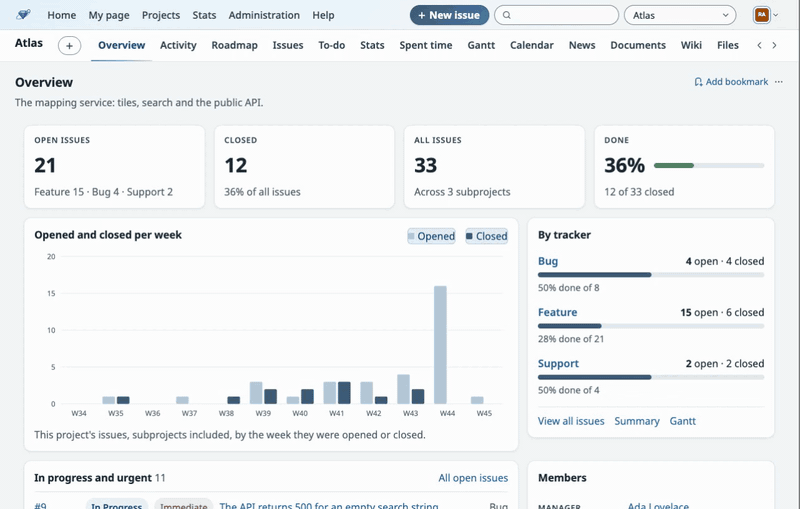

| | |
|---|---|
| 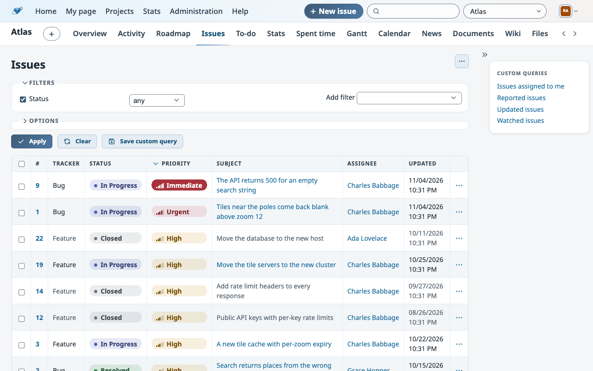 | 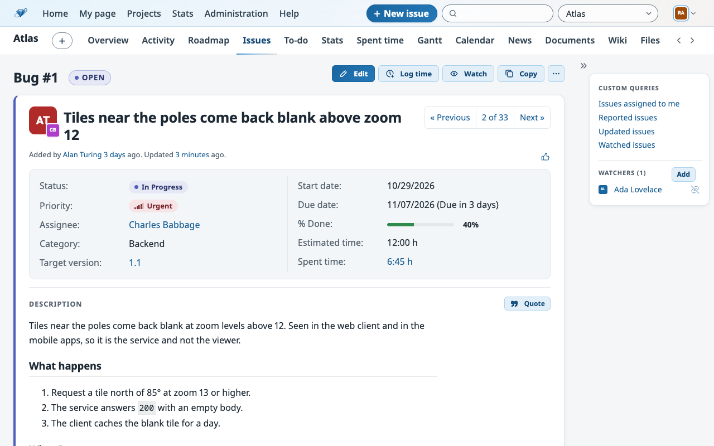 |
| 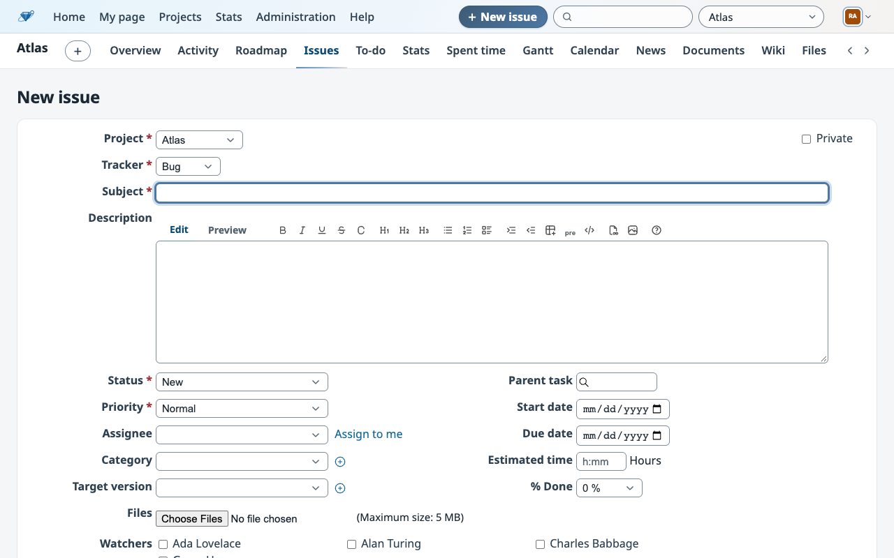 | 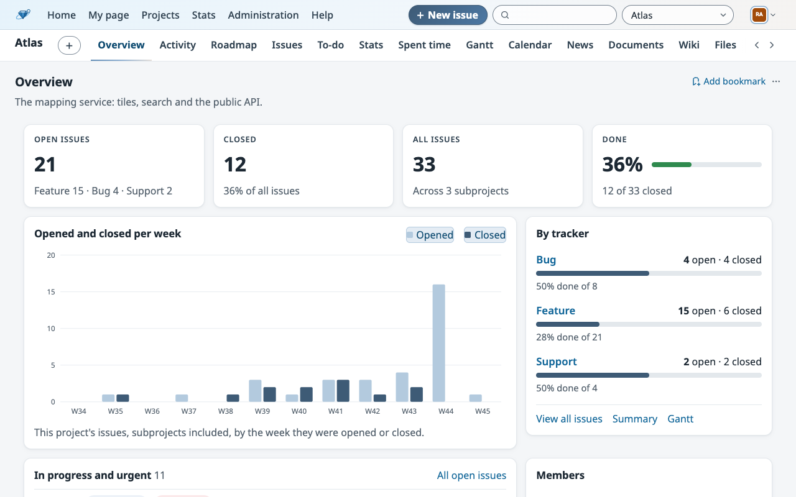 |
| 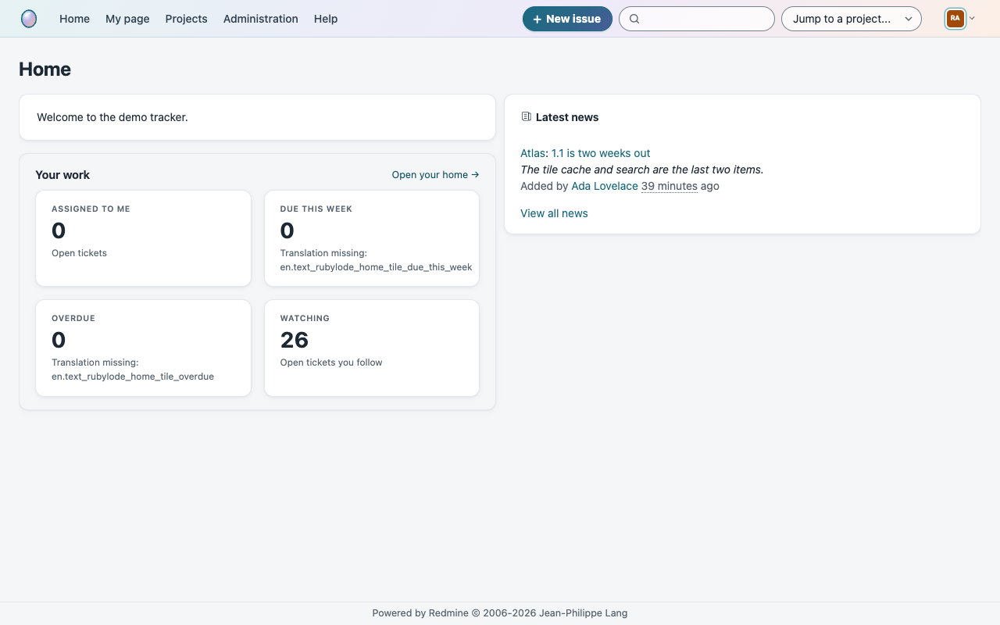 | 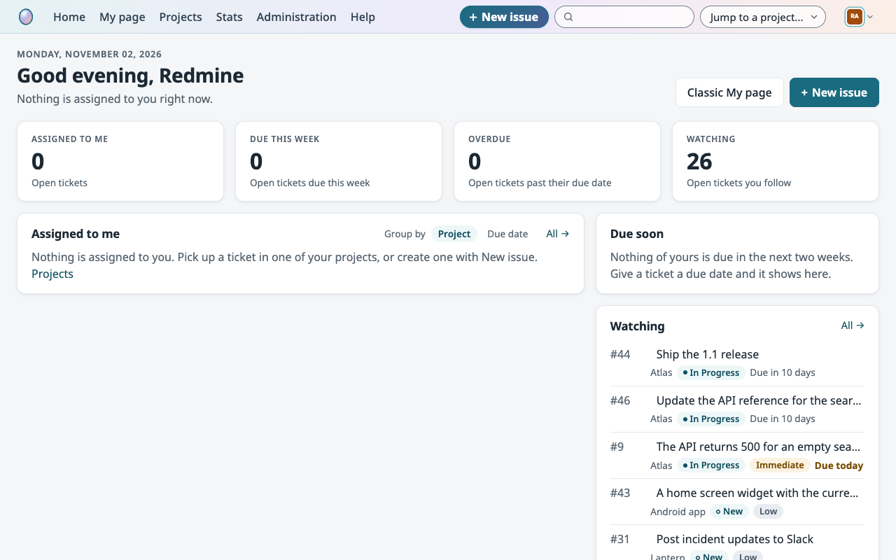 |
| 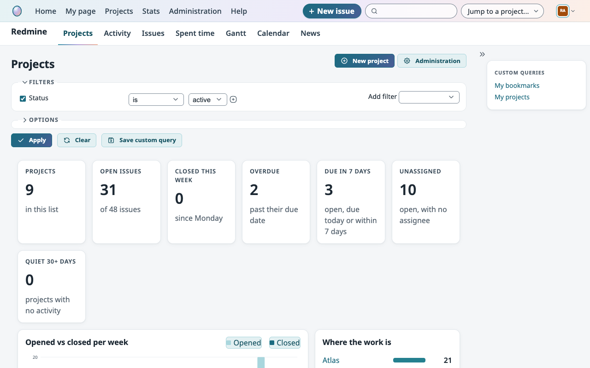 | 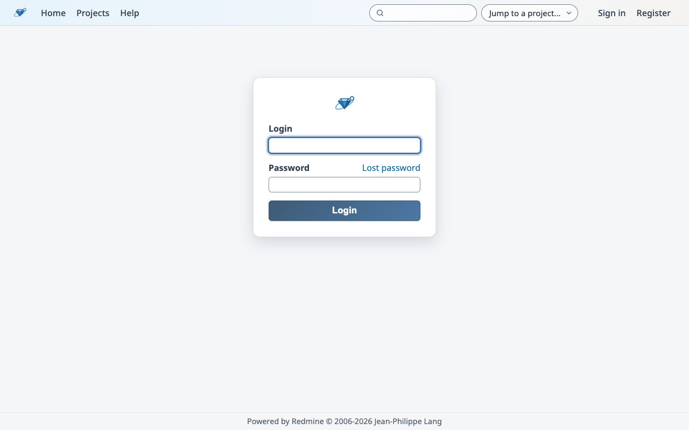 |

Dark mode:

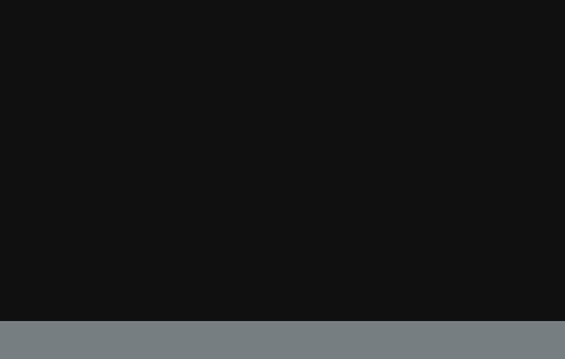

| | |
|---|---|
| 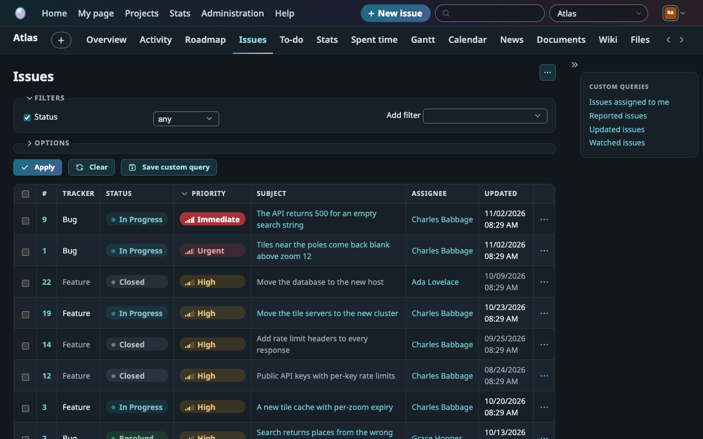 | 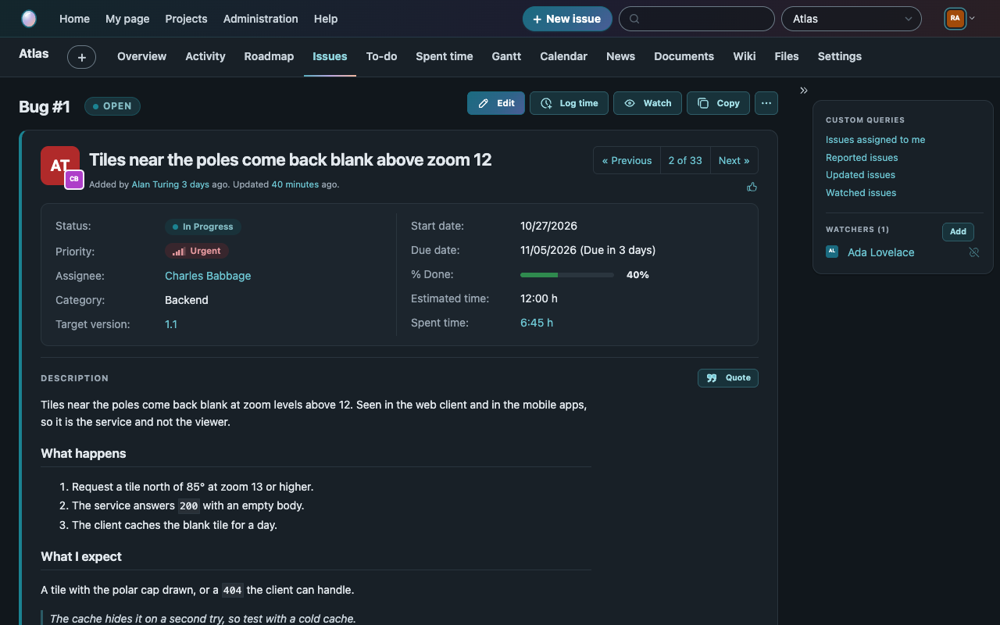 |
| 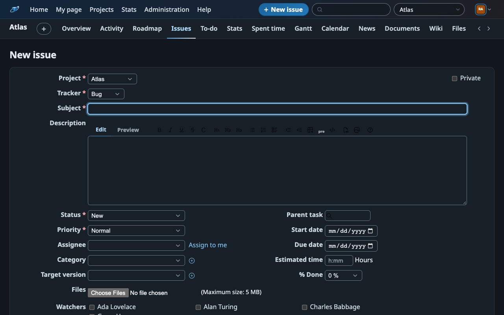 | 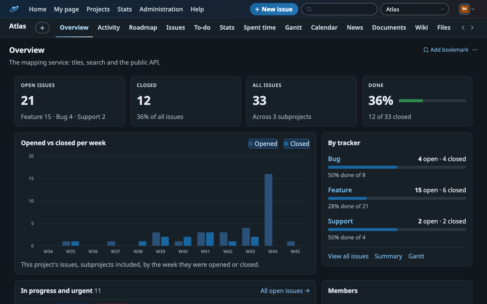 |
| 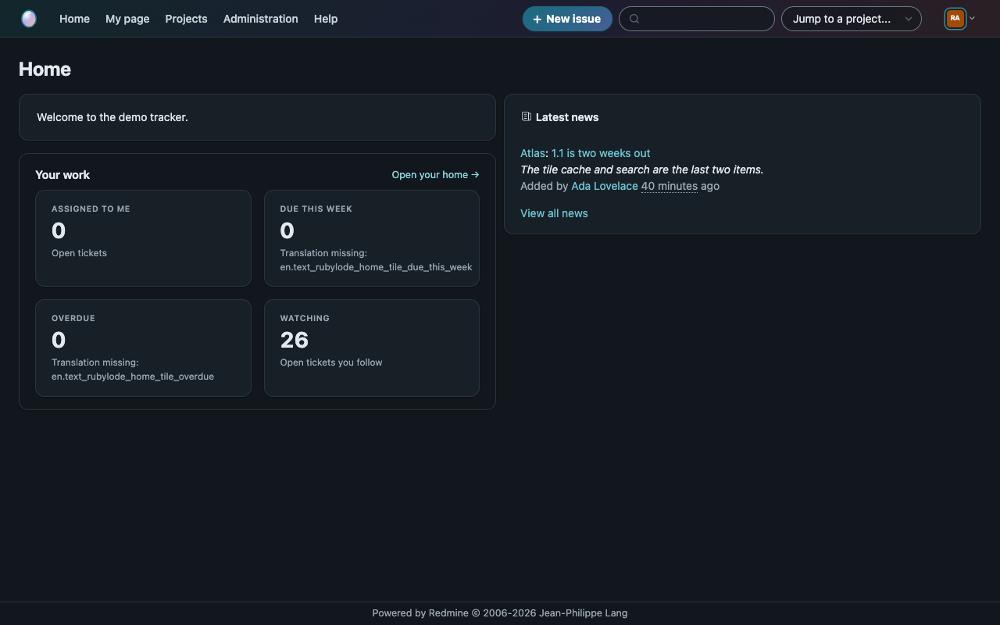 | 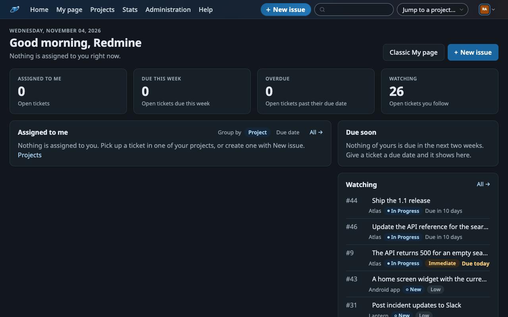 |

The screenshots come from the demo Redmine in this repository; the people, projects and issues in it are made up.

## Contents

- [What it looks like](#what-it-looks-like)
- [Install](#install)
- [What is covered](#what-is-covered)
- [Rubylode plugins](#rubylode-plugins)
- [Customising](#customising)
- [Fonts](#fonts)
- [Dark mode](#dark-mode)
- [Accessibility](#accessibility)
- [Compatibility](#compatibility)
- [Development](#development)
- [Checks and releases](#checks-and-releases)
- [License](#license)

## What it looks like

- A two-row header. The top bar has a teal-to-lilac-to-peach wash, the Opal mark, the global links, the search and project
  switcher as rounded fields, and your avatar. Below it, a white bar holds the project name, the project tabs (the current one
  underlined in the same wash) and the "+" menu.
- A New issue button beside the search, when the Rubylode New issue button plugin is installed.
- Lists are white cards with a header band, a hairline under each row, light column lines, faint stripes and a pale teal hover
  with a coloured edge.
- Status is a chip with a dot (New blue, In Progress teal, Resolved green, Feedback amber, Closed grey, Rejected red). Priority is
  a chip with a five-bar meter: amber for High, red for Urgent, solid red for Immediate.
- An issue is a card with an edge in the status colour, a large subject, labelled parent strips, a segmented previous / next
  control, an attribute panel with a slim % Done bar, framed subtasks and related issues, and a card per note in the history.
- The sidebar, the filters, My page, the project overview, the projects list, activity days and roadmap versions are cards.
  Buttons are tinted, and the main action uses the primary gradient.

## Install

1. Download the zip attached to the latest release (the Releases page of this repository) and unzip it inside the `themes` folder of your Redmine, so that `themes/opal/stylesheets/application.css` exists. Or clone this repository and copy (or link) its `opal` folder into `themes/`.
2. Restart Redmine.
3. In Administration, Settings, Display, choose **Opal** as the theme and save.

To go back, choose another theme on the same page. Nothing is written to the database apart from that setting.

The theme folder holds the stylesheets, `javascripts/theme.js`, the mark (`images/opal-mark.svg`) and a favicon
(`favicon/favicon.ico`, which Redmine links on every page while the theme is chosen). It ships no fonts: it uses the system's own.

## What is covered

The page check loads these pages, in light and dark, at desktop and phone width: sign in, the home page, the project
overview (Redmine's own and the Rubylode Projects plugin's), the projects list, the issue list (plain and grouped), activity, the
roadmap, an issue, an issue with subtasks, a child issue, the edit and new issue forms, the to-do page, the Stats page, the pages
of the four status plugins, My page (Redmine's own and the Rubylode Home plugin's), a wiki page and its editor, spent time, Gantt,
the calendar, project settings and administration.
Flash messages, tabs, the right-click menu, dropdowns, pagination, the text editor and the phone slide-out menu are styled as well.

<!-- rubylode-plugins:start -->
## Rubylode plugins

Opal styles the Rubylode plugins' blocks natively. Each plugin draws with its own CSS custom properties, and one section of the
theme, `opal/stylesheets/plugins.css`, points them at Opal's tokens, so the blocks follow the theme in light and dark:

- [Rubylode Projects](https://github.com/rubylode/redmine-rubylode-projects) (`--rubylode-projects-*`): the overview cards and the projects list.
- [Rubylode Home](https://github.com/rubylode/redmine-rubylode-home) (`--rubylode-home-*`): My page and the welcome page.
- [Rubylode To-do](https://github.com/rubylode/redmine-rubylode-todo) (`--todo-*`): the to-do page.
- [Rubylode Uptime Kuma](https://github.com/rubylode/redmine-rubylode-uptime-kuma) (`--rubylode-uptime-kuma-*`),
  [Rubylode GlitchTip](https://github.com/rubylode/redmine-rubylode-glitchtip) (`--rubylode-glitchtip-*`),
  [Rubylode Windmill](https://github.com/rubylode/redmine-rubylode-windmill) (`--rubylode-windmill-*`) and
  [Rubylode Beszel](https://github.com/rubylode/redmine-rubylode-beszel) (`--rubylode-beszel-*`): the status blocks.
- [Rubylode Stats](https://github.com/rubylode/redmine-rubylode-stats) (`--stats-tooltip-*`): the chart tooltip.
- [Rubylode New issue button](https://github.com/rubylode/redmine-rubylode-new-issue-button): a rounded primary button beside the search.
  Plugins load their stylesheets after the theme's, so these rules start with `body #header` to win whatever the order.

None of them is needed. Without a plugin its rules match nothing.
<!-- rubylode-plugins:end -->

## Customising

Every colour, corner, shadow, font and a few sizes are custom properties in `opal/stylesheets/tokens.css` (light values) and
`opal/stylesheets/dark.css` (dark values). Change them there, or override them from a stylesheet of your own. The names
start with `--theme-` and are the same in every Rubylode theme. The main ones:

| Token | What it is |
|---|---|
| `--theme-page`, `--theme-surface`, `--theme-surface-sunken`, `--theme-surface-hover` | the page, the panels, sunken panels and stripes, hovered rows |
| `--theme-line`, `--theme-line-soft`, `--theme-line-strong` | panel borders and row lines, column lines, field borders |
| `--theme-ink`, `--theme-ink-soft`, `--theme-ink-muted` | text, secondary text, labels and notes |
| `--theme-accent-0` to `--theme-accent-9` | the teal ramp; `--theme-link`, `--theme-primary` and Redmine's blue ramp point into it |
| `--theme-secondary`, `--theme-tertiary` and their `-pale` twins | the lilac and peach shimmer, used in the header, the focus halo and the tab underline |
| `--theme-primary-background`, `--theme-header-background` | the primary button and the top bar (gradients in Opal) |
| `--theme-status-new`, `-in-progress`, `-resolved`, `-feedback`, `-closed`, `-rejected` | status colours, by Redmine's default status ids 1 to 6 |
| `--theme-success`, `--theme-warning`, `--theme-danger`, `--theme-danger-strong` | meaning colours (priority High, Urgent, Immediate) |
| `--theme-radius-small`, `--theme-radius`, `--theme-radius-panel`, `--theme-radius-pill` | corners of fields, cards, panels and pills |
| `--theme-border-width`, `--theme-border-style`, `--theme-density` | panel borders, and the height of table rows and list items |
| `--theme-font-size` | the size of running text (16px); every other text size follows it |
| `--theme-font`, `--theme-font-monospace`, `--theme-title-font`, `--theme-title-weight` | the text, code and heading fonts |

The rest (messages, avatars, diffs, the Gantt chart, the header heights, the icons drawn in the stylesheet) are listed with a
comment each in `tokens.css`.

Status and priority colours are matched by Redmine's default ids (statuses 1 New to 6 Rejected, priorities 1 Low to 5
Immediate). If yours differ, change the ids in the "issue list" and "issue page" sections of `opal/stylesheets/structure.css`.

The labels "Parent" and "Ancestor" above an issue's subject are drawn by CSS, so they are in English only.

## Fonts

Opal ships its own fonts, so text looks the same on every system and nothing is loaded from another site: Noto Sans for
text and Noto Sans Mono for code, as woff2 files in `opal/fonts/` (latin and latin-ext). Both are under the SIL Open
Font License 1.1; the licence texts are in the same folder. A browser downloads a file only when a page uses it. To use other
fonts, change `--theme-font` and `--theme-font-monospace` in `opal/stylesheets/tokens.css`. The size of running text is
`--theme-font-size` (16px), and every other text size follows it.

## Dark mode

Dark mode follows your system setting (`prefers-color-scheme`): a deep slate page, slightly lighter panels, a lighter teal, and
the header wash in deep teal, plum and rose. Code blocks stay light, since
Redmine's syntax colours are made for a light background. To keep Opal light-only, remove the line `@import url(dark.css);`
from `opal/stylesheets/responsive.css`; every dark value is in that one file.

## Accessibility

Text and controls meet WCAG AA in both modes. The page check measures every visible text against the colour behind it on every
page; the tokens were also measured one by one, including the parts the check cannot see (text on the header gradient, field
borders, focus rings). The measured ratios are in [docs/accessibility.md](docs/accessibility.md). In short: body text 13.8:1 in
light and 14.6:1 in dark, secondary text at least 5.6:1 and 6.3:1, links at least 5.7:1 and 6.8:1, white on the primary at least
6.1:1, every status and priority chip at least 5.2:1, field borders and focus rings at least 3.2:1.

## Compatibility

Redmine 7.0 and newer. Tested on 7.0.2, from both the `7.0.2` and the `7.0` image tags (on 2026-11-02 the 7.0 line was at 7.0.2). Older versions are not expected to work: Redmine 7 reads a theme from `themes/<name>` and is
built on the Open Color variables this theme remaps.

Browsers: current Chrome, Edge, Firefox and Safari. The theme uses `:has()` and `color-mix()` (Chrome 111, Firefox 121,
Safari 16.4 and newer); an older browser shows plainer status chips and keeps the rest.

## Development

You need Docker, Ruby, Node and Chrome.

```
npm install
ruby bin/demo up        # a throwaway Redmine with demo data at http://localhost:3110 (admin / admin)
npm run check           # loads every page in light and dark, at desktop and phone width
npm run screenshots     # docs/screenshots
npm run record          # docs/demo, a GIF of a walk through the pages
ruby bin/demo reset     # wipe the demo
```

If copies of the Rubylode plugins listed above sit next to this repository (`../redmine-rubylode-todo` and so on, or in a folder
named in `RUBYLODE_PLUGINS_DIR`), the demo mounts them and the check, screenshots and recording show their pages. The demo points
the status plugins at an address where nothing answers, so their pages show the "unavailable" state. Without the plugins the
demo is plain Redmine, and the check skips their pages.

The stylesheets, `javascripts/theme.js`, `test/`, `bin/demo` and `docker-compose.yml` are generated from the base all Rubylode
themes share, so a fix there reaches every theme. If you send a change to one of them, I will carry it over to the base.

The check fails on console errors, failed requests, sideways scrolling and text below WCAG AA contrast. `REDMINE_TAG=7.0 ruby bin/demo up`
runs it against another Redmine version. After you change a stylesheet, run `ruby bin/demo restart` and reload: Redmine caches theme
files until it restarts.

## Checks and releases

Every push starts a real Redmine from its Docker image (7.0.2 and the 7.0 line), loads every page of the theme in light and dark at desktop and phone width, and fails on console errors, failed requests, sideways scrolling and low text contrast. On GitHub that is `.github/workflows/check.yml`, on GitHub's own runners, and it also runs on pull requests. On a self-hosted Gitea it is `.gitea/workflows/check.yml`, which runs only on pushes to `main`, because that runner works on the host with Docker access and must only run code that is already merged.

A tag such as `v1.0.0` runs the same check, builds `opal-<version>.zip` holding the theme folder, and attaches it to a release with the matching section of `CHANGELOG.md` as its notes (`release.yml` in the same folders). The tag needs a section for that version in the changelog. More on both, and on keeping the self-hosted runner safe, in [docs/ci.md](docs/ci.md).

## License

GPL version 2 or later, the same as Redmine. See `LICENSE`. Copyright (C) 2026  Nick Gorbikoff.

No warranty, as the GPL says. Try it on a copy of your tracker before the real one.
